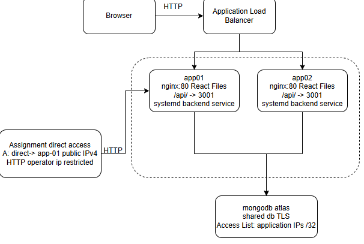
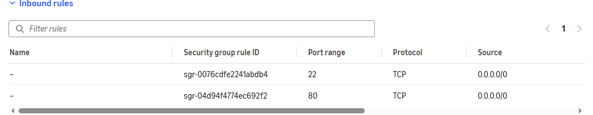
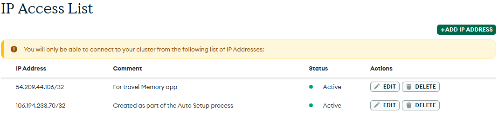

# Travel Memory — AWS Deployment Report

**Assignment 2 · Shubham gupta · 19 Nov 2026**

- **Application:** http://54.175.182.10
- **Repository:** 
- **Region:** Mumbai, `us-east-1`

## 1. Implementation overview

The Travel Memory MERN application was deployed on two Ubuntu EC2 instances in different Availability Zones. Each instance runs Nginx, the React production build, and the Node.js/Express backend. An AWS Application Load Balancer distributes requests, while both backends use a shared MongoDB Atlas database.

The original frontend and backend source code was retained. Deployment used environment variables, Nginx configuration, a systemd service, and AWS networking.

## 2. Architecture



**Request flow:** Browser → Nginx HTTP:80 → Express:3001 → MongoDB Atlas. Nginx serves React files directly and proxies API requests.

| Component | Configuration |
| --- | --- |
| App-01 | `travelmemory-app-01`, t2.micro, ap-south-1b |
| App-02 | `travelmemory-app-02`, t2.micro, ap-south-1a |
| VPC | `vpc-0c3c0bf534f2095c1` |
| AMI | `travelmemory-app-v1`, Private |
| ALB | `travelmemory-alb`, Internet-facing, IPv4 |
| Target group | `travelmemory-app-tg`, Instance targets, HTTP:80 |
| ALB DNS | `travelmemory-backend-alb-1072690551.us-east-1.elb.amazonaws.com` |
| ALB DNS | `travelmemory-frontend-alb-241479792.us-east-1.elb.amazonaws.com` |

## 3. EC2 preparation

App-01 used Ubuntu 24.04.5 LTS, x86_64, approximately 1 GB RAM, and a 6.8 GB root filesystem. Installed packages were `nginx`, `git`, `curl`, and `ca-certificates`. SSH and initial direct HTTP access were restricted to the operator's public IPv4 /32.




## 4. Source and runtime setup

The application was cloned from [UnpredictablePrashant/TravelMemory](https://github.com/UnpredictablePrashant/TravelMemory). Node.js was installed with nvm; the deployed version was **22.23.4**, with **npm 10.9.9**.

```bash
git clone https://github.com/UnpredictablePrashant/TravelMemory.git
nvm install
nvm alias default
cd ~/TravelMemory/backend
npm install
```

## 5. MongoDB Atlas and backend configuration

Each EC2 instance's public outbound IP was allowed in Atlas Network Access as a /32 entry. The backend environment file contained:

```dotenv
MONGO_URI="<ATLAS_CONNECTION_STRING>"
PORT=3001
```

The file was restricted with `chmod 600 .env`. The backend was started with `node index.js` and verified using `/hello` and `/trip` on port 3001. Both returned HTTP 200; `/trip` returned persisted database records.




## 6. Persistent backend service

The [systemd service](../deploy/travelmemory-backend.service) was installed at `/etc/systemd/system/travelmemory-backend.service`. It runs as `ubuntu`, starts on boot, and restarts after process failure.

```bash
sudo systemctl daemon-reload
sudo systemctl enable --now travelmemory-backend
sudo systemctl status travelmemory-backend
```

**Outcome:** The service was enabled and active, and database requests succeeded.

## 7. Frontend configuration and build

The existing `frontend/src/url.js` reads the backend URL from an environment variable. A relative `/api` URL was supplied so the same build works through the instance, ALB, and custom domain.

```bash
cd ~/TravelMemory/frontend
printf 'REACT_APP_BACKEND_URL=/api\n' > .env.production
npm install
npm run build
```

**Outcome:** The production build completed with warnings.

## 8. Nginx configuration

The build was copied to `/var/www/html/`. The [Nginx site configuration](../deploy/travelmemory.nginx.conf) serves React files and forwards `/api/` to http://localhost:3001/. The trailing slash removes the API prefix; React routes fall back to `index.html`.

```bash
npm install
npm run build
sudo rm -rf /var/www/html/*
sudo cp -r build/* /var/www/html/
sudo systemctl restart nginx
curl http://54.175.182.10
```

**Outcome:** Nginx validation passed and the proxied API returned saved trips. The symlink commands apply to initial setup only.


## 9. Application write test

A travel memory was submitted through the UI and appeared in subsequent database reads. An initial attempt failed because Short Description was empty; supplying that required field resolved the save failure without an application source change.

## 10. AMI and second application instance

A private AMI was created from app-01 using **Actions → Image and templates → Create image**. App-02 was launched from this image in **us-east-01**.

**Outcome:** Both services started on app-02, and its proxied API returned the same shared database records.


## 11. Security groups and load balancing

The instance group allows HTTP:80 from `travelmemory-alb-sg`, plus direct HTTP and SSH from the operator's /32. Express port 3001 has no public ingress rule. The ALB accepts public HTTP:80.

Both instances were registered in `travelmemory-app-tg` on port 80. The ALB uses public subnets in both AZs. The configured health-check procedure uses HTTP `/api/hello`, success code 200.

**Outcome:** The ALB became Active, both targets became Healthy, and the application was accessible through its DNS name.


## 14. Outcomes and failover test

| Validation | Outcome |
| --- | --- |
| Backend and database | HTTP 200 from port 3000 and persisted JSON records |
| Process management | Backend service enabled and active |
| Frontend and Nginx | Production build completed; Nginx validation and API proxy passed |
| Create and read a trip | Saved successfully with required fields and displayed in the application |
| Second instance | Services active and shared database accessible |
| Load balancing | Two Healthy targets |
| One-instance shutdown | Intermittent 504s initially; after waiting, the application served successfully without configuration changes. Eventual availability on the survivor was confirmed; the delay was not measured and restoration of both targets was not recorded. |

The HTTP:80 listener still forwards rather than redirects to HTTPS. The final browser screenshot hides the URL scheme; an explicit HTTPS curl transcript would strengthen TLS evidence. Dependency audits reported 19 backend and 103 frontend vulnerabilities; remediation was outside this deployment's scope.

The source, report, screenshots, diagram, and deployment configuration are included in the GitHub repository.